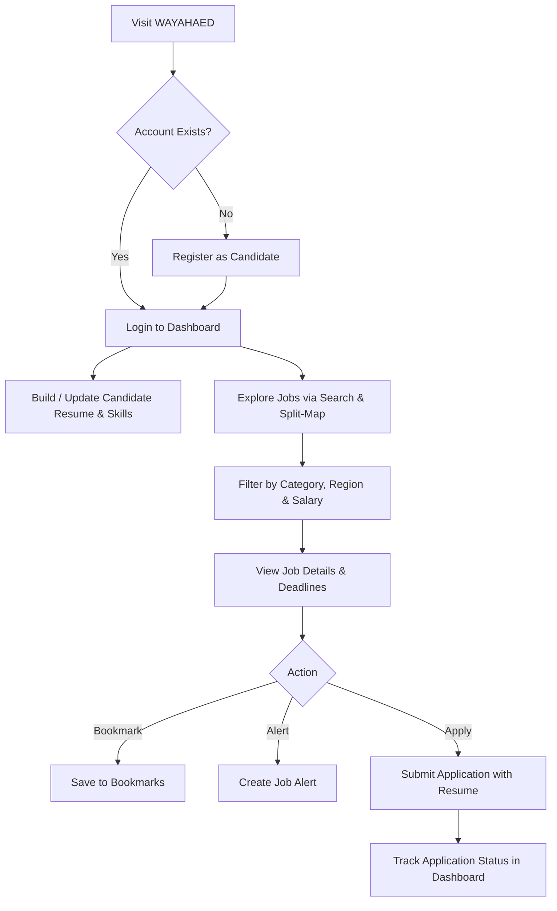
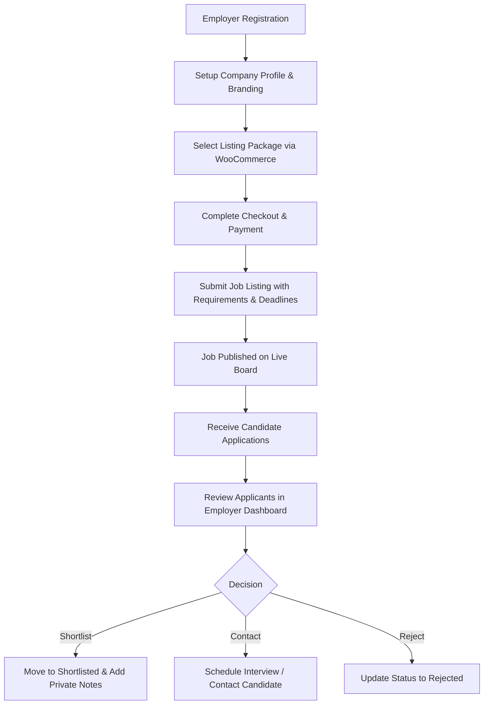
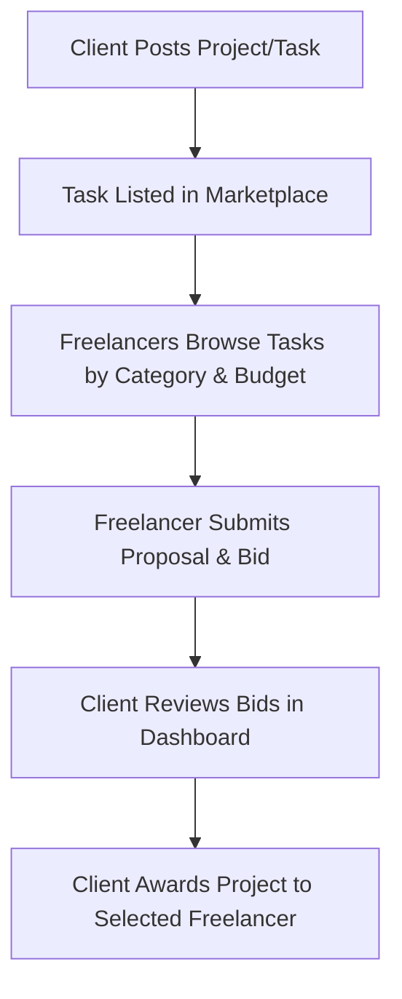

# WAYAHAED (Wayahead) - Recruitment & Freelance Marketplace Platform

[](https://wordpress.org/)
[](http://workscout.in/)
[](https://elementor.com/)
[](https://woocommerce.com/)
[](#)

---

## 📌 Overview

**WAYAHAED** is an enterprise-grade Job Board, Resume Directory, and Freelance Marketplace built on the WordPress ecosystem. It bridges the gap between **Job Seekers / Freelancers** and **Employers / Companies** through a streamlined, end-to-end recruitment pipeline, interactive map searches, applicant tracking, and flexible monetization.

---

## 🏗️ Technology Stack & Core Modules

| Layer | Technologies & Plugins |
| :--- | :--- |
| **Core CMS** | WordPress 6.x (PHP 8.0+, MySQL 8.0+ / MariaDB 10.5+) |
| **Theme Engine** | WorkScout (v4.0.6) by PureThemes with Custom Dashboard templates |
| **Design & UI** | Elementor, Elementor Pro, WorkScout Elementor Widgets, FontAwesome |
| **Job Engine** | WP Job Manager, Company Profiles, Applications ATS, Alerts, Bookmarks |
| **Resume Engine** | WP Job Manager Resumes (candidate profiles, skills taxonomy, CV upload) |
| **Freelance Marketplace** | WorkScout Freelancer (Task posting, bidding, and proposal workflow) |
| **Monetization** | WooCommerce & WP Job Manager WC Paid Listings (Job/Resume packages) |
| **Email & Delivery** | WP Mail SMTP, Contact Form 7 |
| **Performance & Security** | LiteSpeed Cache, WPS Hide Login, Custom `.gitignore` protection |

---

## 🚀 Key Functional Modules

```
WAYAHAED Platform
├── 1. Job Directory & Discovery
│   ├── Interactive Split-Map Search (Location & Radius)
│   ├── Multi-faceted Filtering (Job Type, Category, Salary, Tags)
│   └── Expiration & Application Deadlines
├── 2. Candidate & Resume Management
│   ├── Candidate Resume Builder (Education, Experience, Skills)
│   ├── Portfolio & CV File Attachments
│   └── Candidate Bookmarks & Job Alerts
├── 3. Employer & Company Portal
│   ├── Company Profiles & Employer Branding
│   ├── Applicant Tracking System (ATS: Review, Notes, Statuses)
│   └── Company Reviews & Ratings
├── 4. Freelancer & Task Marketplace
│   ├── Project/Task Publishing
│   └── Freelance Proposal Submission & Bidding
├── 5. Monetization & Checkout
│   ├── Paid Job Posting Packages
│   ├── Featured Listings & Urgent Badges
│   └── Resume Database Subscription Access
└── 6. Unified User Dashboard
    ├── Role-based Dashboards (Candidate vs. Employer)
    ├── Active Listings & Application Management
    └── Profile, Bookmarks & Billing History
```

---

## 🔄 User Workflows & Flow Diagrams

### 1. Job Seeker & Candidate Flow



---

### 2. Employer & Recruiter Flow



---

### 3. Freelance & Task Bidding Flow



---

## 📂 Project Structure & Key Files

```text
e:\wayahead\
├── .gitignore                   # Excludes wp-config.php, media uploads, caches, & zip archives
├── README.md                    # Project documentation & architecture overview
├── wp-config-sample.php         # Database configuration template
├── index.php                    # WordPress entrypoint
│
└── wp-content/
    ├── plugins/
    │   ├── elementor/           # Visual frontend builder
    │   ├── elementor-pro/       # Advanced layout widgets & popups
    │   ├── woocommerce/         # E-commerce store & checkout pipeline
    │   ├── workscout-core/      # Theme core functionality & custom hooks
    │   ├── workscout-elementor/ # Elementor widgets designed for WorkScout
    │   ├── workscout-freelancer/# Task posting, freelance bidding & proposals
    │   ├── wp-job-manager/      # Core job listing post type & workflows
    │   ├── wp-job-manager-resumes/      # Candidate resume database & builder
    │   ├── wp-job-manager-applications/ # Applicant tracking system (ATS)
    │   ├── wp-job-manager-alerts/       # User notification & email alerts
    │   ├── wp-job-manager-bookmarks/    # Saved items for users
    │   ├── wp-job-manager-wc-paid-listings/ # Monetized listing packages
    │   ├── mas-wp-job-manager-company/  # Company profiles & branding
    │   ├── mas-wp-job-manager-company-reviews/ # Company ratings & reviews
    │   └── litespeed-cache/     # Cache & site optimization
    │
    └── themes/
        └── workscout/           # Active WorkScout Theme (v4.0.6)
            ├── functions.php    # Theme setup, Kirki options, asset enqueue
            ├── style.css        # Main stylesheet & theme declarations
            ├── template-dashboard.php     # Unified candidate/employer dashboard
            ├── template-jobs.php          # Main job search page
            ├── template-jobs-fullpage.php # Full-page job listings
            ├── template-splitmap.php      # Half-map / half-list layout
            ├── template-resumes.php       # Candidate resume directory
            ├── template-tasks.php         # Freelance tasks & projects page
            ├── single-company.php         # Detailed company page
            ├── single-job_listing.php     # Single job detail template
            └── single-resume.php          # Candidate public resume view
```

---

## ⚙️ Installation & Local Setup

### 1. Prerequisites
- **Web Server**: Apache 2.4+ (with `mod_rewrite`) or Nginx
- **PHP**: Version 8.0 or 8.1+ with extensions: `mysqli`, `curl`, `gd`, `mbstring`, `xml`, `zip`
- **Database**: MySQL 5.7+ / 8.0+ or MariaDB 10.4+

### 2. Environment Configuration
1. Clone this repository into your local web root:
   ```bash
   git clone https://github.com/Utkarsh31017/WAYAHAED.git
   ```
2. Create your local database (e.g., `wayahead_db`).
3. Copy `wp-config-sample.php` to `wp-config.php` and configure your credentials:
   ```php
   define( 'DB_NAME', 'wayahead_db' );
   define( 'DB_USER', 'your_db_user' );
   define( 'DB_PASSWORD', 'your_db_password' );
   define( 'DB_HOST', 'localhost' );
   ```
4. Generate new security keys and salts from [WordPress.org Secret-Key Service](https://api.wordpress.org/secret-key/1.1/salt/) and paste them into `wp-config.php`.

### 3. File Permissions
Ensure the following directories are writeable by the web server process:
```bash
chmod -R 755 wp-content
```

---

## 🔒 Security Best Practices

- **Never commit `wp-config.php`**: Database credentials and authentication salts must remain local.
- **Backups & Uploads Ignored**: Large archives (`*.zip`, `*.tar.gz`) and user uploads are managed outside Git via [.gitignore](.gitignore) to prevent hitting GitHub's 100MB quota.
- **Admin Access Protection**: Use `wps-hide-login` to prevent automated brute-force attacks on the standard `/wp-login.php` endpoint.

---

## 👨‍💻 Maintainers
- **Repository**: [Utkarsh31017 / WAYAHAED](https://github.com/Utkarsh31017/WAYAHAED)
